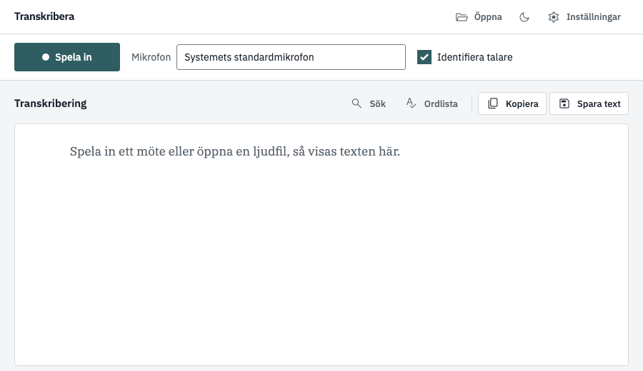
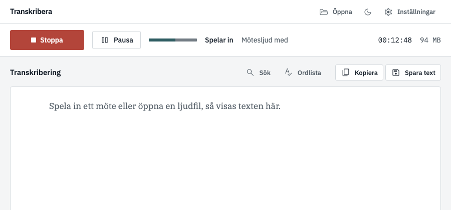
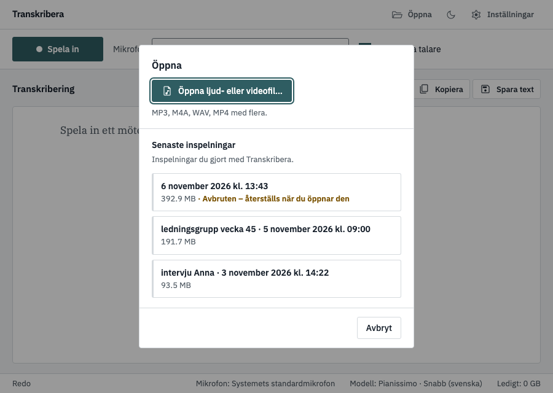
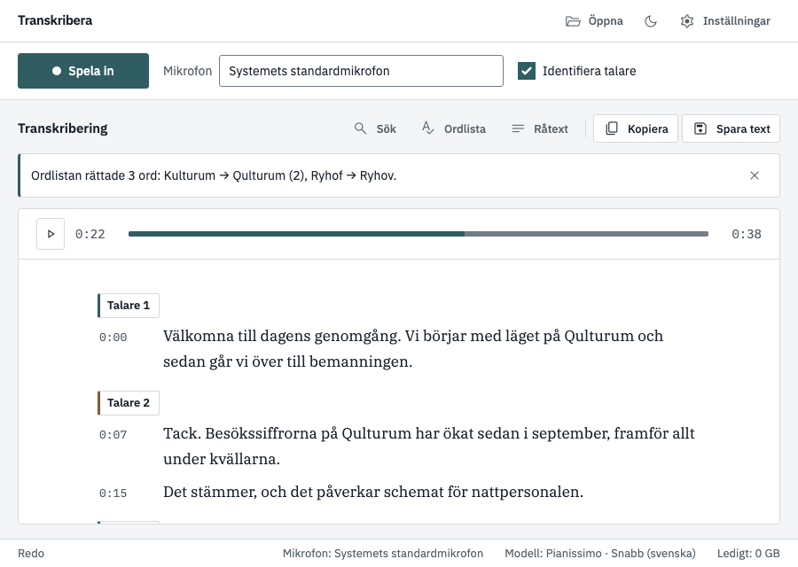
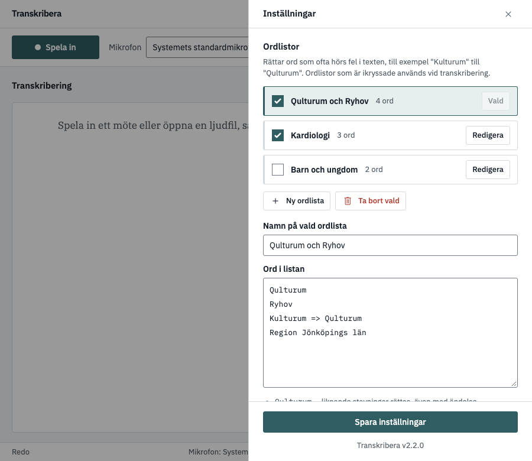
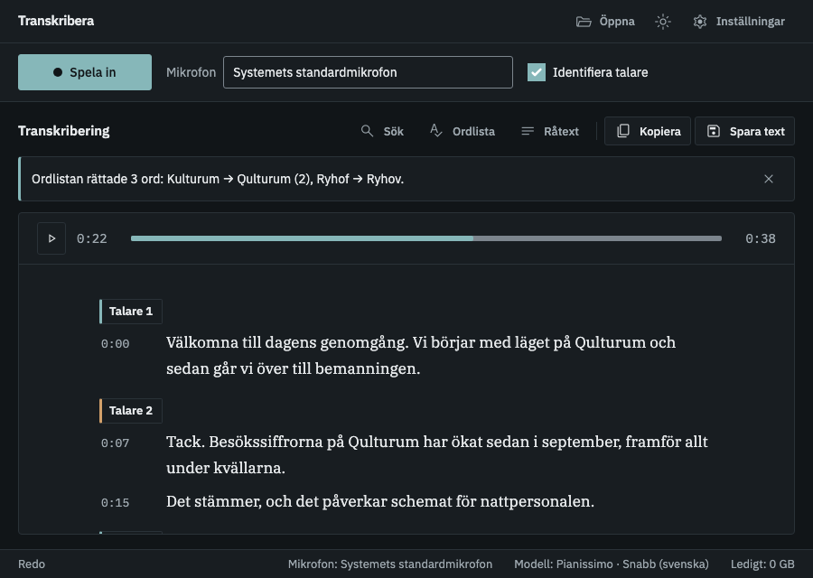

# Kom igång med Transkribera

Från nedladdning till färdig text på ungefär fem minuter. Allt sker på din egen dator, ditt ljud skickas aldrig någonstans.

## 1. Ladda ner och starta

1. Gå till [Releases](https://github.com/mrswedish/transcrptr/releases) och ladda ner **`Transkribera-portable.exe`**. Det är en enda fil, ingen installation behövs.
2. Lägg filen i en mapp du kan hitta igen (till exempel Hämtade filer) och dubbelklicka på den.
3. Visar Windows en blå ruta ("SmartScreen"): klicka **Mer information** och sedan **Kör ändå**.

## 2. Första starten

Första gången hämtar appen språkmodellen **Snabbast** (ca 0,7 GB). Det behöver internet och görs **bara en gång**. Därefter fungerar allt utan nätverk. Vänta tills statusraden längst ned säger **Redo**.

## 3. Få text: spela in eller öppna en fil

**Spela in ett möte**

1. Välj din **mikrofon** (oftast räcker "Systemets standardmikrofon").
2. Ska du spela in ett digitalt möte i Teams eller Zoom? Kryssa i **Spela in mötesljud**, annars hörs bara din egen röst.
3. Tryck **Spela in**. Tryck **Stoppa** när du är klar.
4. Välj **Transkribera nu**, eller **Spara för senare** om du vill transkribera en annan gång. Ljudet ligger då kvar på disken.

**Eller öppna en ljudfil**

Tryck **Öppna** uppe till höger och välj **Öppna ljud- eller videofil…** (MP3, M4A, WAV, MP4 med flera). Där finns också en lista med dina **senaste inspelningar**.

> Avbröts en inspelning (till exempel om datorn startade om)? Den syns i listan som **Avbruten** och återställs automatiskt när du öppnar den.

## 4. Vem sa vad? (valfritt)

Kryssa i **Identifiera talare** *innan* du transkriberar. Första gången hämtas två små modeller (ca 33 MB). Det tar några minuter extra per timme ljud, och en förloppsrad visar hur långt det har kommit. Klicka på en talarrubrik ("Talare 1") för att skriva ett namn, så ändras det överallt.

## 5. Läs, rätta och spara

- **Rätta:** klicka på en rad (eller tryck Enter när den är markerad), skriv, och tryck Esc när du är klar.
- **Lyssna:** klicka på en tidsstämpel (till exempel `0:21`) för att hoppa dit i inspelningen.
- **Sök och ersätt:** tryck **Ctrl+F**.
- **Spara:** **Kopiera** lägger texten i urklipp, **Spara text** skapar en `.txt`-fil.

## Bra att veta

**Ordlista.** Hör appen ett ord fel varje gång, till exempel "Kulturum" i stället för "Qulturum"? Rätta ordet i texten, så frågar appen om det ska läggas i ordlistan, och rättar resten av texten direkt. Du kan också skapa flera ordlistor (till exempel en per avdelning) under **Inställningar → Ordlistor**.

**Mörkt tema.** Tryck på månen uppe till höger.

**Gör om.** Vill du prova en annan modell? Byt under **Inställningar → Modell** och tryck **Gör om**.

**Går något fel?** Kraschar transkriberingen eller fungerar inte mötesljudet? Se [README](README.md#om-transkriberingen-kraschar). Inställningarna har en knapp **Öppna loggfil** som hjälper vid felsökning.
