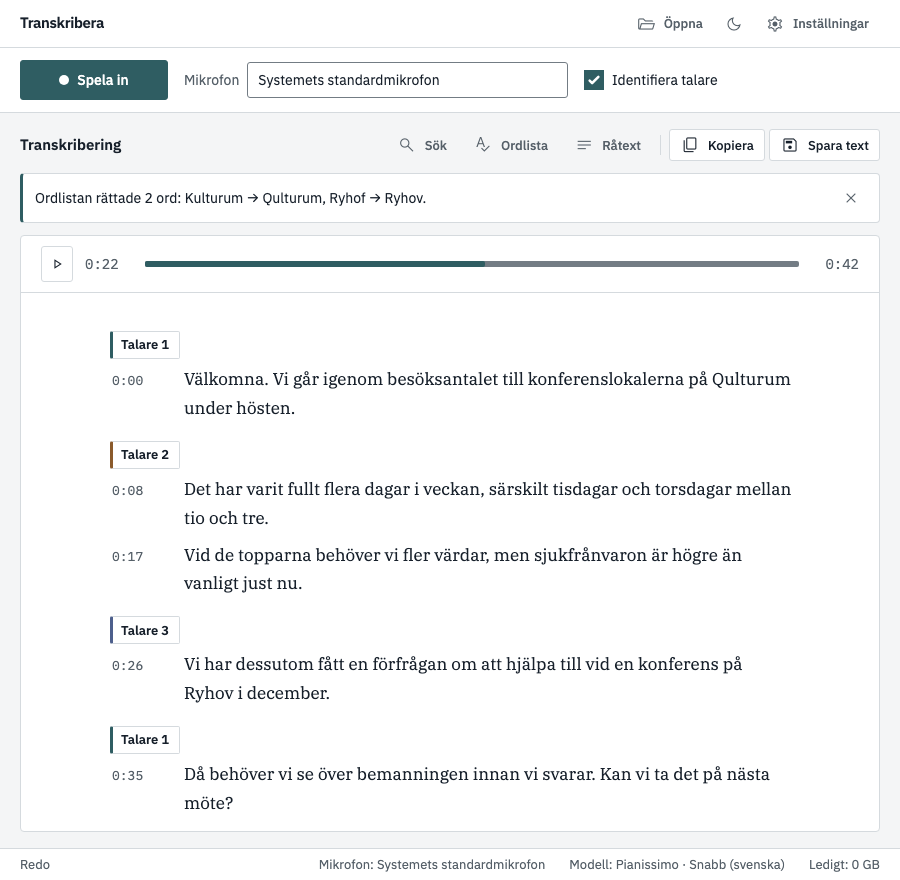
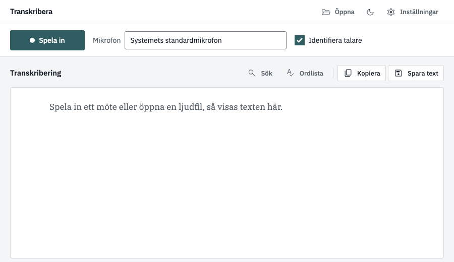
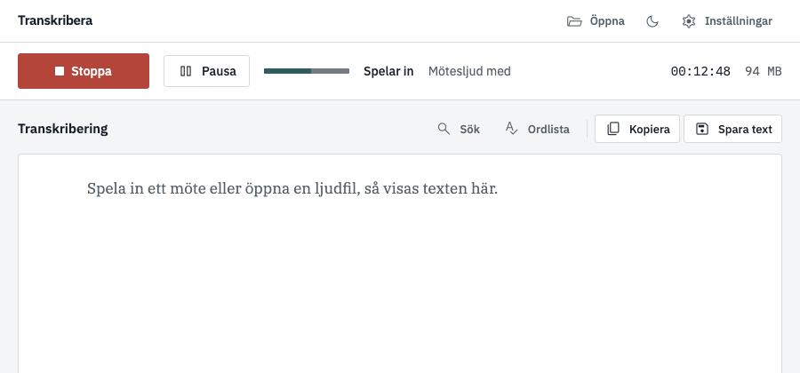
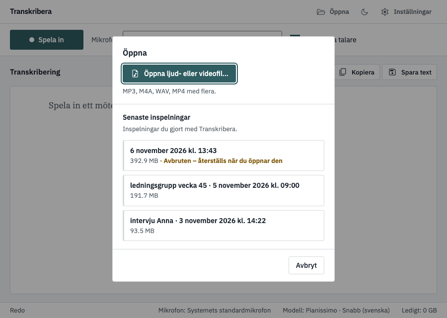
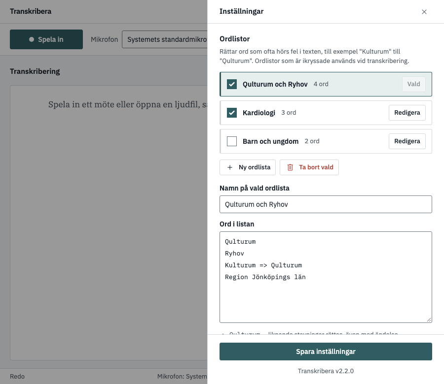
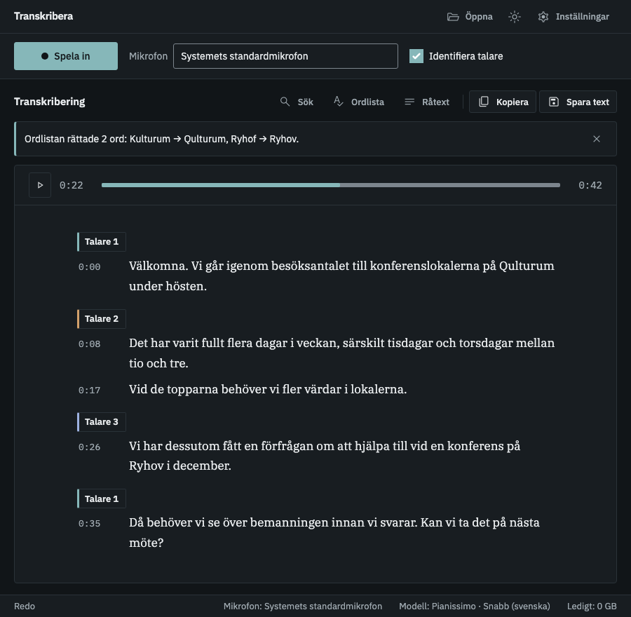

# Transkribera

Transkribera är en lokal, integritetsfokuserad skrivbordsapp som omvandlar tal till text — helt utan molntjänster. Allt sker på din egen dator; ditt ljud och din röstdata lämnar aldrig din maskin.



> **För IT och förvaltare:** [Teknisk dokumentation](TEKNISK-DOKUMENTATION.md) beskriver var data
> lagras, vilken nätverkstrafik som förekommer, vad som blir kvar vid avinstallation och hur
> systemet är byggt.

## 🚀 Kom igång

1. Ladda ner `Transkribera-portable.exe` från [Releases](https://github.com/mrswedish/transcrptr/releases) och dubbelklicka. Första starten hämtar språkmodellen en gång (ca 0,7 GB).
2. Tryck **Spela in** (eller **Öppna** för en ljudfil) och sedan **Transkribera nu**.
3. Rätta texten genom att klicka på den. **Kopiera** eller **Spara text** när du är klar.

Det finns en [steg för steg-guide med bilder](KOM-IGANG.md).

## 🖼️ Så ser det ut

| | |
|---|---|
|  **Start.** Spela in eller öppna en fil. |  **Inspelning** med timer och nivåmätare. |
|  **Öppna** med senaste inspelningar. Avbrutna återställs. |  **Ordlistor**, flera per verksamhet. |
|  **Mörkt tema.** |  **Transkript** med talare, spelare och tidsstämplar. |

## 🇸🇪 Fokus på svenska

Standardmodellen **Snabbast** är [Pianissimo](https://klang.ai/pianissimo-sv/) från Klang AI, en svensk taligenkänningsmodell som går på processorn och oftast är snabbast på vanliga datorer. Vill du ha högsta möjliga noggrannhet finns [KB-whisper](https://huggingface.co/KBLab/kb-whisper-small) från **Kungliga biblioteket (KB)** — specialtränad på **50 000+ timmar** svenskt tal, däribland tv-sändningar, riksdagstal och dialekter från hela landet.

> **Andra språk?** Engelska och blandade språk kräver en Whisper-modell (välj **Flera språk** under Inställningar → Modell). Resultatet blir bäst på svenska.

📰 [Läs mer om KB-whisper på Kungliga bibliotekets hemsida](https://www.kb.se/om-oss/nyheter/nyhetsarkiv/2025-02-20-valtranad-ai-modell-forvandlar-tal-till-text.html)

## ✨ Funktioner
- **🔒 Integritet:** Ditt ljud stannar på din dator. Inget skickas till externa servrar. [Integritetspolicy](PRIVACY.md)
- **⚡ Snabbt på vanliga datorer:** Standardmodellen Pianissimo går på processorn och behöver inget grafikkort. Whisper-modellerna kan dessutom använda grafikkortet (Vulkan på Windows), vilket kan stängas av för äldre grafikkort.
- **🎙️ Mötesinspelning (Windows):** Spela in både mikrofon och datorljud från t.ex. Teams/Zoom — via WASAPI Endpoint Loopback (fungerar från Windows 7) eller Stereo Mix (se guide nedan).
- **🔌 Fungerar helt offline:** Inget hämtas från internet vid start — allt utseende och alla typsnitt finns i programmet. Endast modellnedladdning kräver nätverk, och den sker bara en gång.
- **💽 Automatisk sparning till disk:** Allt inspelat material streamas direkt till en tidsstämplad sessionsmapp (`inspelning-...`) under inspelningens gång — skyddar mot dataförlust vid krasch eller strömavbrott. Efter stopp visas sökvägen till mappen direkt i appen (klicka för att öppna i Utforskaren).
- **⏭️ Spara för senare:** Efter en inspelning kan du välja *Transkribera nu* eller *Spara för senare* — det senare stänger dialogen direkt så du hinner starta nästa möte. Ge inspelningen ett valfritt namn så blir sessionsmappen lätt att hitta igen (`inspelning-20260903-142233-ledningsgrupp`).
- **🌗 Ljust och mörkt tema:** Växla direkt med temaknappen i appens överkant. Första gången följer appen datorns inställning.
- **📂 Öppna fil eller tidigare inspelning:** Transkribera valfri ljudfil — MP3, M4A, AAC, WAV, OGG, FLAC, MP4, WebM, MKV — eller välj bland dina senaste inspelningar i en lista. Avbrutna inspelningar (t.ex. efter en krasch) är markerade och återställs automatiskt. Avkodningen sker helt i Rust (Symphonia) utan att belasta JS-heapen — fungerar även för inspelningar på flera timmar.
- **🎚️ Antialiaserad ljudbehandling:** Lågpassfilter (cutoff 7 kHz) före nedsampling till 16 kHz — minskar aliasing-artefakter från 44.1k/48k-källor (iPhone, Mac mic) för bättre transkribering.
- **⏹️ Avbryt transkribering:** Avbryt pågående transkribering när som helst med en knapp. Inspelad audio bevaras alltid och kan sparas även efter avbrott.
- **🔄 Gör om transkribering:** Byt modell och kör om utan att spela in på nytt.
- **👥 Identifiera talare:** Valfri kryssruta som märker "Talare 1, 2, …" och låter dig döpa om dem. Körs helt lokalt (se nedan).
- **✏️ Redigera transkribering:** Redigera, sök och ersätt direkt i appen (Ctrl+F).
- **📝 Personliga ordlistor:** Flera ordlistor (till exempel per avdelning) med facktermer och egennamn. Efter transkriberingen rättas liknande felhörningar automatiskt, oavsett motor — till exempel "Kulturum" till "Qulturum", även med ändelse ("Kulturumet" blir "Qulturumet"). Rättar du ett ord i segmentvyn kan du lägga till det i ordlistan med ett klick. Listorna sparas i en fil som kan säkerhetskopieras. För Whisper skickas orden dessutom som ledtråd.
- **🎬 Segmentredigering:** Visa transkriberingen som tidsstämplade rader — klicka på en tidsstämpel för att hoppa direkt till den punkten i inspelningen. Progressiv rendering håller UI:t responsivt även för flertimmes-transkriberingar.
- **🔊 Synkad ljudspelare:** Spela upp inspelningen direkt i appen med automatisk markering av det aktiva textsegmentet.
- **〰️ Osäkra ord (Whisper):** Ord med låg igenkänningssäkerhet får en prickad understrykning i segmentvyn. Tröskelvärdet justeras under Avancerat i inställningarna.
- **💾 Spara:** Exportera text som `.txt` eller spara inspelningen som en ny `.wav`-fil (originalet ligger redan kvar i sessionsmappen).
- **🗑️ Rensa inspelningar:** Radera alla sparade sessionsmappar med ett klick i inställningarna. Visar antal och total storlek först, och rör bara inspelningsmappar — sparade textfiler och exporterade ljudfiler lämnas orörda.
- **📊 Modellhantering:** Se, ladda ner och ta bort modeller i inställningarna.
- **💿 Diskhantering:** Inställningarna visar hur mycket plats dina inspelningar tar, och appen varnar om diskutrymmet är lågt innan du startar en lång inspelning.

## 🖥️ Plattformsstöd

Windows är det stödda målet. Inspelning och mötesljud fungerar bara i Windows-versionen; på Mac pausas utvecklingen tills vidare (filimport och transkribering finns kvar i koden men testas inte).

## 📦 Välj rätt modell

Byt modell under **Inställningar → Modell**. Där finns tre färdiga val, och du kan ladda ner flera och byta med ett klick.

| Val i appen | Modell | Storlek | Språk | Passar för |
|---|---|---|---|---|
| **Snabbast** *(förvalt)* | Pianissimo | ~0,7 GB | Svenska | De flesta möten på vanliga datorer |
| **Noggrann** | KB-whisper Medium | ~0,9 GB | Svenska | Högre noggrannhet och markering av osäkra ord, men tar längre tid |
| **Flera språk** | Whisper Large-v3-Turbo | ~1,5 GB | 100+ språk | Engelska facktermer, blandspråk, internationella möten |

Första gången appen startar hämtas **Snabbast** automatiskt. Är språket engelska eller automatiskt (under Inställningar → Språk) används en nedladdad Whisper-modell i stället, eftersom Pianissimo bara kan svenska.

### Pianissimo — "Snabbast" (svenska, standardval)

[Pianissimo](https://klang.ai/pianissimo-sv/) från Klang AI är en svensk taligenkänningsmodell (finjusterad NVIDIA Parakeet TDT 0.6B) som körs via ONNX Runtime **på processorn** — inget grafikkort behövs. Standardmodell från och med v1.8.0 och avsedd att gå snabbare än Whisper på vanliga datorer. På en 27 minuter lång inspelning tog transkriberingen ca 2 minuter på en arbetslaptop (Ryzen).

**Nackdelar:** bara svenska, ingen ordnivå-markering av osäkra ord, och något högre felfrekvens än KB-whisper i Klangs egna tester. Kräver Microsofts VC++-runtime, som finns på praktiskt taget alla Windows-datorer.

Modellvikterna licensieras under [CC BY 4.0](https://creativecommons.org/licenses/by/4.0/) (Klang AI, baserad på NVIDIA Parakeet TDT 0.6B v3). Förbehandling och avkodning följer den MIT-licensierade referensimplementationen i [Avskrift](https://github.com/Pluggentipsar/avskrift). Se `NOTICE`.

### KB-whisper — "Noggrann" (svenska)

[KB-whisper](https://huggingface.co/KBLab/kb-whisper-small) från Kungliga biblioteket, specialtränad på 50 000+ timmar svenskt tal. Medium-modellen hämtas i formatet **q5_0**, som är ca 40 % mindre än standardformatet med i princip identisk kvalitet.

Har du laddat ned större eller ordagranna KB-modeller i en äldre version fungerar de fortfarande. Under **Inställningar → Modell** finns knappen **Rensa oanvända modeller** som tar bort dem och frigör diskutrymme.

### Whisper Turbo — "Flera språk"

OpenAIs officiella large-v3-turbo-modell (q8_0) från [ggerganov/whisper.cpp](https://huggingface.co/ggerganov/whisper.cpp). Välj den när du transkriberar på flera språk, blandar svenska med engelska facktermer, eller när hastighet är viktigare än maximal noggrannhet på svenska. KB-whisper slår Turbo på ren svenska.

## 👥 Identifiera talare (valfritt)

Kryssrutan **Identifiera talare** i huvudfönstret märker vem som säger vad ("Talare 1", "Talare 2", …). Klicka på en talarrubrik för att döpa om talaren, och namnen följer med vid kopiering och sparande.

- **Lokalt:** funktionen använder [speakrs](https://github.com/avencera/speakrs), en Rust-version av pyannotes community-1-pipeline, och körs på processorn utan grafikkort.
- **Modeller:** två små modeller (ca 33 MB) hämtas från huggingface.co första gången kryssrutan används. Därefter fungerar den helt utan internet.
- **Tid:** det tar några minuter extra per timme ljud (ca 4 minuter för 27 minuter ljud på en Ryzen-laptop). En förloppsrad visar hur långt det har kommit.
- **Avbryt:** knappen **Avbryt talaridentifiering** stoppar steget inom någon sekund. Transkriptet är då sparat, men utan talare.

## 📝 Ordlistor

Under **Inställningar → Ordlistor** kan du skapa flera ordlistor, till exempel en per avdelning. Efter transkriberingen rättas liknande felhörningar automatiskt, oavsett modell. Rättar du ett ord i texten kan du lägga till det i ordlistan med ett klick.

```text
Qulturum                      ← liknande stavningar rättas, även med ändelse (Kulturumet → Qulturumet)
Kulturum => Qulturum          ← exakt felstavning som ska bli rätt ord
=Qulturum                     ← bara exakt träff, inga liknande ord
```

Listorna ligger i filen `ordlistor.json` i appens datamapp, så de kan säkerhetskopieras.

## 🎙️ Spela in möten — Mötesljud (Windows)

Det finns två sätt att spela in både din mikrofon och datorns ljud (Teams, Zoom, Spotify m.fl.):

| | **Spela in mötesljud** *(WASAPI Loopback)* | **Stereo Mix** *(Windows-funktion)* |
|---|---|---|
| **Kräver inställning i Windows** | Nej | Ja (engångsinställning) |
| **Windows-version** | Windows 7+ | Alla versioner |
| **Välj mikrofon i appen** | Ja | Nej (styrs av Windows) |
| **Datorns ljud** | Ja | Ja |
| **Drivrutinsstöd** | Oberoende av hårdvara | Beror på ljudkortet |

### Alternativ 1: Spela in mötesljud (rekommenderas)

Kryssa i **Spela in mötesljud** i huvudfönstret, intill mikrofonvalet, innan du trycker **Spela in**. Det är inte en inställning i kugghjulsmenyn. Transkribera använder **klassisk WASAPI Endpoint Loopback** för att fånga datorns ljud digitalt — oberoende av hårdvara och drivrutiner.

**Hur det fungerar:** Transkribera lyssnar automatiskt på Windows standardljudenhet (t.ex. hörlurar eller högtalare) **och** på kommunikationsenheten (den enhet Teams, Zoom m.fl. använder). Om de är olika enheter — t.ex. Jabra Speak för möten men inbyggda högtalare för övrigt — fångas båda och mixas automatiskt. Under inspelning står **Mötesljud med** i inspelningsraden, vilket bekräftar att datorns ljud spelas in. Är rutan inte ikryssad visas en påminnelse om att bara din egen mikrofon spelas in.

> [!NOTE]
> Fungerar från Windows 7 och uppåt — inget behov av en specifik Windows-version.

> [!IMPORTANT]
> Starta alltid mötet och se till att ljud spelas **innan** du trycker Spela in i Transkribera. Om du använder en separat USB-enhet (t.ex. Jabra) för möten — se till att den är vald som kommunikationsenhet i Windows ljudinställningar.

### Alternativ 2: Stereo Mix (alternativ metod)

Stereo Mix är en virtuell Windows-enhet som fångar allt systemljud och mixar det med valfri mikrofon. Kräver en engångsinställning i Windows. En guide med steg finns också i appen under **Inställningar → Inspelningar → Hjälp med mötesljud**.

1. **Öppna ljudinställningar:** Högerklicka på ljudikonen i aktivitetsfältet → välj **"Ljudinställningar"**.
2. **Hitta detaljerade steg:** Scrolla längst ner och klicka på **"Mer ljudinställningar"** (viktigt för Windows 11).
3. **Visa enheter:** I fönstret som öppnas, gå till fliken **Inspelning**. Högerklicka på en tom yta och aktivera **"Visa inaktiverade enheter"**.
4. **Aktivera:** Högerklicka på **Stereo Mix** → **Aktivera**.
5. **Sätt som standard:** Högerklicka på **Stereo Mix** igen → **"Ange som standardenhet"**.
6. **Välj i appen:** Välj **"Systemets standardmikrofon"** i mikrofonlistan i Transkribera.

> [!IMPORTANT]
> Starta alltid mötet och se till att ljud spelas **innan** du trycker Spela in i Transkribera.

> [!NOTE]
> Syns inte Stereo Mix? Din dators ljudkort saknar stöd för det. Använd **Spela in mötesljud** i stället.

## 📥 Ladda ner och installera (Windows)

Gå till [Releases](https://github.com/mrswedish/transcrptr/releases) för senaste versionen och ladda ner `Transkribera-portable.exe`.

### Om transkriberingen kraschar

Pianissimo ("Snabbast") använder inte grafikkortet, så det här gäller bara **Whisper-modellerna** (Noggrann och Flera språk). Det enklaste är då att byta till **Snabbast** under Inställningar → Modell.

På datorer med **flera grafikkort eller en NPU** (t.ex. laptop med Intel Arc + NVIDIA, eller Intel AI Boost) kan Vulkan välja "fel" grafikkort och appen kraschar tyst när transkriberingen startar. Workaround:

1. Öppna **Inställningar → Avancerat**.
2. Ange ett **GPU-index** under GPU-acceleration: testa `0`, sedan `1`, sedan `2` osv tills transkriberingen fungerar — detta tvingar Whisper att bara använda just det grafikkortet.
3. Om inget GPU-index fungerar: sänk **CPU-trådar för Whisper** till **4** och stäng av **GPU-acceleration** — det är långsammare men ska inte krascha.

Om problemet kvarstår: öppna **Inställningar → Avancerat → Öppna loggfil** och skicka loggens innehåll för diagnostik.

### Mapp för inspelningar

Sökvägen under **Inställningar → Inspelningar → Mapp** används både som **streamningsmapp** under inspelning och som plats för den färdiga `recording.wav`. Varje inspelning får en egen undermapp (`inspelning-ÅÅÅÅMMDD-TTMMSS`). Som standard används mappen `Transkribera-Inspelningar` bredvid `Transkribera-portable.exe` (vanligen i din Downloads-mapp), eftersom företagsdatorer ofta omdirigerar Documents till en nätverksdisk, vilket gör skrivningar där långsamma och riskabla under långa inspelningar.

**Tips:** Välj alltid en lokal mapp (t.ex. `C:\Users\<dittnamn>\Downloads`) — undvik UNC-paths (`\\server\...`) eftersom skrivningar mot nätverksdisk under pågående inspelning kan hänga och tappa hela inspelningen.

**Öppna en gammal eller avbruten inspelning:** Klicka **Öppna** i appens överkant. Där ligger en lista över dina senaste inspelningar; välj en så öppnas den. Inspelningar som avbröts (till exempel om appen kraschade) är markerade och återställs automatiskt när du öppnar dem — råspåren mixas ihop till en spelbar inspelning. Vid start visar appen också en rad om den hittar en avbruten inspelning.

### Windows SmartScreen och säkerhet

Eftersom appen inte är köpt med ett kommersiellt kodsigneringscertifikat kan Windows varna vid första körningen. Så här hanterar du det:

**SmartScreen-varning ("Windows skyddade din dator"):**
1. Klicka på **"Mer information"**
2. Klicka sedan på **"Kör ändå"**

**Filen är "blockerad" av Windows:**
På vissa Windows-versioner kan filer laddade från internet blockeras. Om appen inte startar:
1. Högerklicka på `.exe`-filen
2. Välj **"Egenskaper"**
3. Längst ner under fliken **Allmänt** — kryssa i **"Avblockera"**
4. Klicka **OK** och starta appen igen

> [!NOTE]
> Transkribera innehåller ingen skadlig kod. Varningarna beror på att appen distribueras utan kommersiell kodsignering. Källkoden är öppen och granskningsbar på GitHub.

## 🏗️ Teknisk arkitektur

Transkribera bygger på **Tauri 2** — en Rust-backend kombinerad med ett webbfrontend. All tung bearbetning sker i Rust; webbvyn hanterar enbart gränssnittet.

### Kärnkomponenter

| Komponent | Teknologi | Roll |
|-----------|-----------|------|
| **Desktop-ram** | Tauri 2 (Rust) | Fönsterhantering, IPC-brygga, systemdialog |
| **Motor: Pianissimo** | `ort` (ONNX Runtime) + egen Rust-kod | FastConformer/TDT-modell på CPU. ONNX Runtime laddas dynamiskt från en inbäddad `onnxruntime.dll`. Log-mel-features och TDT-avkodning är skrivna i Rust (`pianissimo.rs`) |
| **Motor: Whisper** | whisper-rs / whisper.cpp | C++-optimerad Whisper-inferens (Vulkan på Windows) |
| **Motorgränssnitt** | `Engine`-trait (`engine.rs`) | Gemensam chunk-loop för båda motorerna |
| **Talaridentifiering** | speakrs (lokal kopia i `src-tauri/vendor/`) | pyannote community-1-pipelinen i ren Rust på CPU |
| **Ordlistor** | `vocabulary.rs` | Lagring i `ordlistor.json` och efterkorrigering av transkriptet |
| **Ljudavkodning (fil)** | Symphonia (Rust) | Avkodar MP3, M4A/AAC, WAV, OGG, FLAC strömmande, utan JS-heap |
| **Mikrofon (inspelning)** | Webbläsarens `getUserMedia` + AudioWorklet | Mikrofonljudet skickas som rå binär f32-data till Rust (`append_mic_chunk`) |
| **Mötesljud (Windows)** | WASAPI Endpoint Loopback | Fångar eConsole + eCommunications, skrivs direkt till disk i Rust |
| **WAV-kodning** | hound (Rust) | Skriver 16-bit PCM-WAV direkt till disk |
| **Frontend** | Vanilla JS + Tailwind CSS 3 | Beroendefritt UI med lokala typsnitt (IBM Plex) och inbyggda ikoner |

Inställningar sparas i webbläsarens `localStorage`; ordlistor ligger i en egen fil. Se den [tekniska dokumentationen](TEKNISK-DOKUMENTATION.md) för var data lagras.

### Minneshantering och Windows-optimeringar

WebView2 (Chromium-motorn i Tauri på Windows) kan inte allokera stora sammanhängande block i JS-heapen. En 2-timmars M4A-inspelning kräver ~460 MB som ett enda block vid avkodning i JavaScript — vilket kraschar processen tyst.

Transkribera löser detta genom att flytta all tung bearbetning till Rust:

**Filimport — Rust-side avkodning med Symphonia:**
- JS skickar enbart filsökvägen (en sträng) till Rust via Tauri-kommandot `transcribe_file`.
- Rust avkodar filen med Symphonia, resamplar till 16 kHz mono (med lågpassfilter vid 7 kHz mot aliasing) och delar upp i 5-minuters-chunks.
- Motorn transkriberar varje chunk direkt i Rust — JS-heapen belastas aldrig med ljuddata.
- Minnespeak: ~19 MB per chunk, oavsett fillängd. Den valfria talaridentifieringen läser därefter in hela ljudet en gång (ca 230 MB per timme).

**Inspelning — direkt till disk:**
- Allt inspelat material streamas till en sessionsmapp (`inspelning-…`) medan du spelar in, så inget går förlorat vid en krasch.
- Mikrofonen skrivs till `mic.wav`, mötesljudet till `lb_console.wav` och `lb_comms.wav`. När du stoppar mixas spåren ihop till `recording.wav`.
- Avbryts en inspelning mixas råspåren ihop när du öppnar den i listan över senaste inspelningar.

### Dataflöde — filimport

```
Fil på disk (MP3 / M4A / WAV / OGG / FLAC / …)
  │
  ▼  Rust: Symphonia avkodar + resamplar till 16 kHz mono f32
  │
  ▼  Rust: delar upp i 5-min-chunks (~19 MB/st)
  │
  ▼  Rust: vald motor (Pianissimo eller Whisper) transkriberar chunk för chunk
  │        (avbrytflaggan kontrolleras mellan varje chunk)
  │
  ▼  Rust: ordlistorna rättar texten
  │
  ▼  Rust (valfritt): speakrs märker talare och tilldelar dem till segmenten
  │
  ▼  JS: tar emot segmentlista [{startMs, endMs, text, tokens, speakerId}]
  │
  ▼  UI: visar transkribering + segmentredigerare + spelare
```

### Dataflöde — inspelning (Windows)

```
Mikrofon ──► getUserMedia + AudioWorklet ──► append_mic_chunk ──► mic.wav
                                                                       │
Mötesljud ─► WASAPI Endpoint Loopback ─────────────────────► lb_console.wav / lb_comms.wav
                                                                       │
                                  stopp: mix + resample ───────────────┘
                                                      │
                                                recording.wav
                                                      │
                                ┌─────────────────────┴───────────────────┐
                                │                                         │
                        "Spara för senare"                       "Transkribera nu"
                        (ligger kvar på disk,                    transcribe_file(recording.wav)
                         syns i Öppna)
```

## 🛠️ Bygga från källkod

### Förutsättningar
- [Node.js](https://nodejs.org/) (v20+)
- [Rust](https://www.rust-lang.org/tools/install) 1.89 eller senare
- [CMake](https://cmake.org/) (för whisper.cpp)
- **Windows:** Visual Studio Build Tools (C++) och [Vulkan SDK](https://vulkan.lunarg.com/)

### Köra i utvecklingsläge
```bash
git clone https://github.com/mrswedish/transcrptr.git
cd transcrptr
npm install
npm run tauri dev
```

`npm run build:css` bygger stilarna (körs automatiskt av Tauri). Rust-testerna körs med `cargo test` i `src-tauri/`.

### Windows-bygge med Pianissimo
Pianissimo laddar en inbäddad `onnxruntime.dll` (Microsofts ONNX Runtime 1.24.2). Release-bygget hämtar den, kontrollerar kontrollsumman och bygger med `--features embedded-ort`. Se `.github/workflows/build-windows.yml` för de exakta stegen.

## Tillgänglighet

Appen är granskad mot WCAG 2.1 AA (EN 301 549). Se [TILLGANGLIGHET.md](TILLGANGLIGHET.md) för vad som är gjort och vad som återstår att verifiera (bland annat test med skärmläsare).
